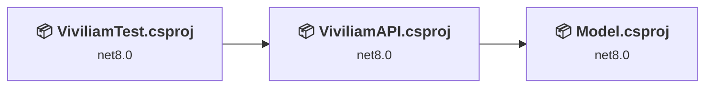
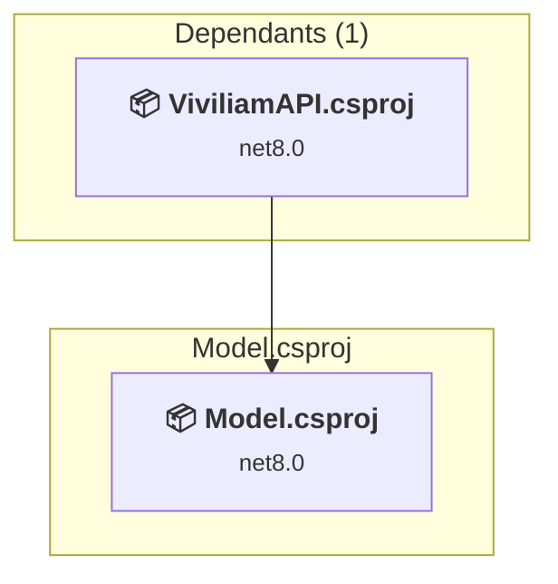
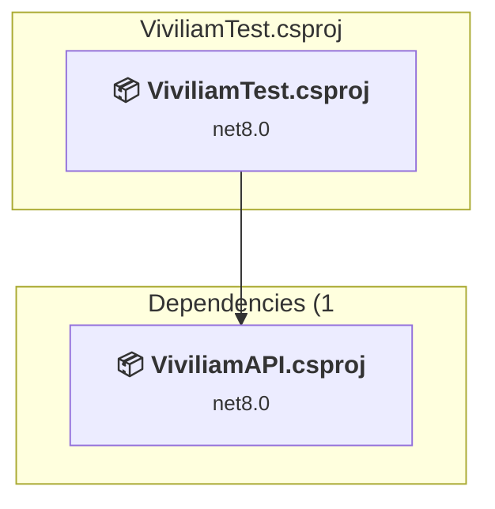
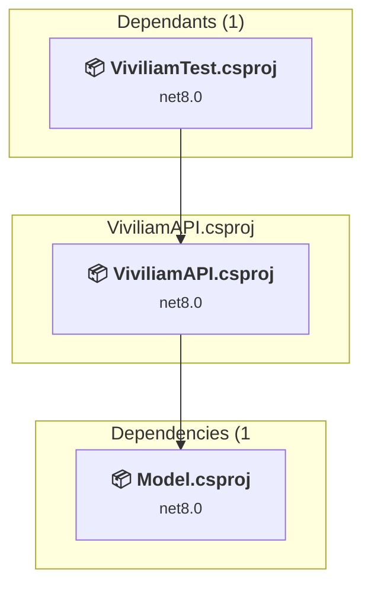

# Projects and dependencies analysis

This document provides a comprehensive overview of the projects and their dependencies in the context of upgrading to .NETCoreApp,Version=v10.0.

## Table of Contents

- [Executive Summary](#executive-Summary)
  - [Highlevel Metrics](#highlevel-metrics)
  - [Projects Compatibility](#projects-compatibility)
  - [Package Compatibility](#package-compatibility)
  - [API Compatibility](#api-compatibility)
  - [Binding Redirect Configuration](#binding-redirect-configuration)
- [Aggregate NuGet packages details](#aggregate-nuget-packages-details)
- [Top API Migration Challenges](#top-api-migration-challenges)
  - [Technologies and Features](#technologies-and-features)
  - [Most Frequent API Issues](#most-frequent-api-issues)
- [Projects Relationship Graph](#projects-relationship-graph)
- [Project Details](#project-details)

  - [Model\Model.csproj](#modelmodelcsproj)
  - [ViviliamTest\ViviliamTest.csproj](#viviliamtestviviliamtestcsproj)
  - [WebApi\ViviliamAPI.csproj](#webapiviviliamapicsproj)

## Executive Summary

### Highlevel Metrics

| Metric | Count | Status |
| :--- | :---: | :--- |
| Total Projects | 3 | All require upgrade |
| Total NuGet Packages | 96 | 8 need upgrade |
| Total Code Files | 11 |  |
| Total Code Files with Incidents | 5 |  |
| Total Lines of Code | 1412 |  |
| Total Number of Issues | 488 |  |
| Estimated LOC to modify | 477+ | at least 33.8% of codebase |

### Projects Compatibility

| Project | Target Framework | Difficulty | Package Issues | API Issues | Binding Issues | Est. LOC Impact | Description |
| :--- | :---: | :---: | :---: | :---: | :---: | :---: | :--- |
| [Model\Model.csproj](#modelmodelcsproj) | net8.0 | 🟢 Low | 0 | 0 | 0 |  | ClassLibrary, Sdk Style = True |
| [ViviliamTest\ViviliamTest.csproj](#viviliamtestviviliamtestcsproj) | net8.0 | 🟢 Low | 2 | 0 | 0 |  | DotNetCoreApp, Sdk Style = True |
| [WebApi\ViviliamAPI.csproj](#webapiviviliamapicsproj) | net8.0 | 🟢 Low | 6 | 477 | 0 | 477+ | AspNetCore, Sdk Style = True |

### Package Compatibility

| Status | Count | Percentage |
| :--- | :---: | :---: |
| ✅ Compatible | 88 | 91.7% |
| ⚠️ Incompatible | 2 | 2.1% |
| 🔄 Upgrade Recommended | 6 | 6.3% |
| ***Total NuGet Packages*** | ***96*** | ***100%*** |

### API Compatibility

| Category | Count | Impact |
| :--- | :---: | :--- |
| 🔴 Binary Incompatible | 0 | High - Require code changes |
| 🟡 Source Incompatible | 475 | Medium - Needs re-compilation and potential conflicting API error fixing |
| 🔵 Behavioral change | 2 | Low - Behavioral changes that may require testing at runtime |
| ✅ Compatible | 2087 |  |
| ***Total APIs Analyzed*** | ***2564*** |  |

## Aggregate NuGet packages details

| Package | Current Version | Suggested Version | Projects | Description |
| :--- | :---: | :---: | :--- | :--- |
| Azure.Core | 1.35.0 |  | [ViviliamAPI.csproj](#webapiviviliamapicsproj) [ViviliamTest.csproj](#viviliamtestviviliamtestcsproj) | ✅Compatible |
| Azure.Identity | 1.10.3 |  | [ViviliamAPI.csproj](#webapiviviliamapicsproj) [ViviliamTest.csproj](#viviliamtestviviliamtestcsproj) | ✅Compatible |
| Castle.Core | 5.1.1 |  | [ViviliamTest.csproj](#viviliamtestviviliamtestcsproj) | ✅Compatible |
| coverlet.collector | 6.0.0 |  | [ViviliamTest.csproj](#viviliamtestviviliamtestcsproj) | ✅Compatible |
| Microsoft.Bcl.AsyncInterfaces | 1.1.1 |  | [ViviliamAPI.csproj](#webapiviviliamapicsproj) [ViviliamTest.csproj](#viviliamtestviviliamtestcsproj) | ✅Compatible |
| Microsoft.CodeCoverage | 17.8.0 |  | [ViviliamTest.csproj](#viviliamtestviviliamtestcsproj) | ✅Compatible |
| Microsoft.CSharp | 4.5.0 |  | [ViviliamAPI.csproj](#webapiviviliamapicsproj) [ViviliamTest.csproj](#viviliamtestviviliamtestcsproj) | ✅Compatible |
| Microsoft.Data.SqlClient | 5.1.5 |  | [ViviliamAPI.csproj](#webapiviviliamapicsproj) [ViviliamTest.csproj](#viviliamtestviviliamtestcsproj) | ✅Compatible |
| Microsoft.Data.SqlClient.SNI.runtime | 5.1.1 |  | [ViviliamAPI.csproj](#webapiviviliamapicsproj) [ViviliamTest.csproj](#viviliamtestviviliamtestcsproj) | ✅Compatible |
| Microsoft.EntityFrameworkCore | 8.0.10 | 10.0.15 | [ViviliamAPI.csproj](#webapiviviliamapicsproj) [ViviliamTest.csproj](#viviliamtestviviliamtestcsproj) | NuGet package upgrade is recommended |
| Microsoft.EntityFrameworkCore.Abstractions | 8.0.10 |  | [ViviliamAPI.csproj](#webapiviviliamapicsproj) [ViviliamTest.csproj](#viviliamtestviviliamtestcsproj) | ✅Compatible |
| Microsoft.EntityFrameworkCore.Analyzers | 8.0.10 |  | [ViviliamAPI.csproj](#webapiviviliamapicsproj) [ViviliamTest.csproj](#viviliamtestviviliamtestcsproj) | ✅Compatible |
| Microsoft.EntityFrameworkCore.Relational | 8.0.10 |  | [ViviliamAPI.csproj](#webapiviviliamapicsproj) [ViviliamTest.csproj](#viviliamtestviviliamtestcsproj) | ✅Compatible |
| Microsoft.EntityFrameworkCore.SqlServer | 8.0.10 | 10.0.15 | [ViviliamAPI.csproj](#webapiviviliamapicsproj) [ViviliamTest.csproj](#viviliamtestviviliamtestcsproj) | NuGet package upgrade is recommended |
| Microsoft.Extensions.ApiDescription.Server | 6.0.5 |  | [ViviliamAPI.csproj](#webapiviviliamapicsproj) [ViviliamTest.csproj](#viviliamtestviviliamtestcsproj) | ✅Compatible |
| Microsoft.Extensions.Caching.Abstractions | 8.0.0 |  | [ViviliamAPI.csproj](#webapiviviliamapicsproj) [ViviliamTest.csproj](#viviliamtestviviliamtestcsproj) | ✅Compatible |
| Microsoft.Extensions.Caching.Memory | 8.0.1 |  | [ViviliamAPI.csproj](#webapiviviliamapicsproj) [ViviliamTest.csproj](#viviliamtestviviliamtestcsproj) | ✅Compatible |
| Microsoft.Extensions.Configuration | 8.0.0 | 10.0.15 | [ViviliamAPI.csproj](#webapiviviliamapicsproj) [ViviliamTest.csproj](#viviliamtestviviliamtestcsproj) | NuGet package upgrade is recommended |
| Microsoft.Extensions.Configuration.Abstractions | 8.0.0 |  | [ViviliamAPI.csproj](#webapiviviliamapicsproj) [ViviliamTest.csproj](#viviliamtestviviliamtestcsproj) | ✅Compatible |
| Microsoft.Extensions.Configuration.Binder | 8.0.0 |  | [ViviliamAPI.csproj](#webapiviviliamapicsproj) [ViviliamTest.csproj](#viviliamtestviviliamtestcsproj) | ✅Compatible |
| Microsoft.Extensions.Configuration.FileExtensions | 8.0.0 |  | [ViviliamAPI.csproj](#webapiviviliamapicsproj) [ViviliamTest.csproj](#viviliamtestviviliamtestcsproj) | ✅Compatible |
| Microsoft.Extensions.Configuration.Json | 8.0.0 | 10.0.15 | [ViviliamAPI.csproj](#webapiviviliamapicsproj) [ViviliamTest.csproj](#viviliamtestviviliamtestcsproj) | NuGet package upgrade is recommended |
| Microsoft.Extensions.DependencyInjection | 8.0.1 |  | [ViviliamAPI.csproj](#webapiviviliamapicsproj) [ViviliamTest.csproj](#viviliamtestviviliamtestcsproj) | ✅Compatible |
| Microsoft.Extensions.DependencyInjection.Abstractions | 8.0.2 |  | [ViviliamAPI.csproj](#webapiviviliamapicsproj) [ViviliamTest.csproj](#viviliamtestviviliamtestcsproj) | ✅Compatible |
| Microsoft.Extensions.DependencyModel | 8.0.0 |  | [ViviliamAPI.csproj](#webapiviviliamapicsproj) [ViviliamTest.csproj](#viviliamtestviviliamtestcsproj) | ✅Compatible |
| Microsoft.Extensions.Diagnostics.Abstractions | 8.0.0 |  | [ViviliamAPI.csproj](#webapiviviliamapicsproj) [ViviliamTest.csproj](#viviliamtestviviliamtestcsproj) | ✅Compatible |
| Microsoft.Extensions.FileProviders.Abstractions | 8.0.0 |  | [ViviliamAPI.csproj](#webapiviviliamapicsproj) [ViviliamTest.csproj](#viviliamtestviviliamtestcsproj) | ✅Compatible |
| Microsoft.Extensions.FileProviders.Physical | 8.0.0 |  | [ViviliamAPI.csproj](#webapiviviliamapicsproj) [ViviliamTest.csproj](#viviliamtestviviliamtestcsproj) | ✅Compatible |
| Microsoft.Extensions.FileSystemGlobbing | 8.0.0 |  | [ViviliamAPI.csproj](#webapiviviliamapicsproj) [ViviliamTest.csproj](#viviliamtestviviliamtestcsproj) | ✅Compatible |
| Microsoft.Extensions.Hosting.Abstractions | 8.0.0 |  | [ViviliamAPI.csproj](#webapiviviliamapicsproj) [ViviliamTest.csproj](#viviliamtestviviliamtestcsproj) | ✅Compatible |
| Microsoft.Extensions.Logging | 8.0.1 |  | [ViviliamAPI.csproj](#webapiviviliamapicsproj) [ViviliamTest.csproj](#viviliamtestviviliamtestcsproj) | ✅Compatible |
| Microsoft.Extensions.Logging.Abstractions | 8.0.2 |  | [ViviliamAPI.csproj](#webapiviviliamapicsproj) [ViviliamTest.csproj](#viviliamtestviviliamtestcsproj) | ✅Compatible |
| Microsoft.Extensions.Options | 8.0.2 |  | [ViviliamAPI.csproj](#webapiviviliamapicsproj) [ViviliamTest.csproj](#viviliamtestviviliamtestcsproj) | ✅Compatible |
| Microsoft.Extensions.Primitives | 8.0.0 |  | [ViviliamAPI.csproj](#webapiviviliamapicsproj) [ViviliamTest.csproj](#viviliamtestviviliamtestcsproj) | ✅Compatible |
| Microsoft.Identity.Client | 4.56.0 |  | [ViviliamAPI.csproj](#webapiviviliamapicsproj) [ViviliamTest.csproj](#viviliamtestviviliamtestcsproj) | ✅Compatible |
| Microsoft.Identity.Client.Extensions.Msal | 4.56.0 |  | [ViviliamAPI.csproj](#webapiviviliamapicsproj) [ViviliamTest.csproj](#viviliamtestviviliamtestcsproj) | ✅Compatible |
| Microsoft.IdentityModel.Abstractions | 6.35.0 |  | [ViviliamAPI.csproj](#webapiviviliamapicsproj) [ViviliamTest.csproj](#viviliamtestviviliamtestcsproj) | ✅Compatible |
| Microsoft.IdentityModel.JsonWebTokens | 6.35.0 |  | [ViviliamAPI.csproj](#webapiviviliamapicsproj) [ViviliamTest.csproj](#viviliamtestviviliamtestcsproj) | ✅Compatible |
| Microsoft.IdentityModel.Logging | 6.35.0 |  | [ViviliamAPI.csproj](#webapiviviliamapicsproj) [ViviliamTest.csproj](#viviliamtestviviliamtestcsproj) | ✅Compatible |
| Microsoft.IdentityModel.Protocols | 6.35.0 |  | [ViviliamAPI.csproj](#webapiviviliamapicsproj) [ViviliamTest.csproj](#viviliamtestviviliamtestcsproj) | ✅Compatible |
| Microsoft.IdentityModel.Protocols.OpenIdConnect | 6.35.0 |  | [ViviliamAPI.csproj](#webapiviviliamapicsproj) [ViviliamTest.csproj](#viviliamtestviviliamtestcsproj) | ✅Compatible |
| Microsoft.IdentityModel.Tokens | 6.35.0 |  | [ViviliamAPI.csproj](#webapiviviliamapicsproj) [ViviliamTest.csproj](#viviliamtestviviliamtestcsproj) | ✅Compatible |
| Microsoft.NET.Test.Sdk | 17.8.0 |  | [ViviliamTest.csproj](#viviliamtestviviliamtestcsproj) | ✅Compatible |
| Microsoft.NETCore.Platforms | 5.0.0 |  | [ViviliamAPI.csproj](#webapiviviliamapicsproj) [ViviliamTest.csproj](#viviliamtestviviliamtestcsproj) | ✅Compatible |
| Microsoft.NETCore.Targets | 1.1.0 |  | [ViviliamAPI.csproj](#webapiviviliamapicsproj) [ViviliamTest.csproj](#viviliamtestviviliamtestcsproj) | ✅Compatible |
| Microsoft.OpenApi | 1.2.3 |  | [ViviliamAPI.csproj](#webapiviviliamapicsproj) [ViviliamTest.csproj](#viviliamtestviviliamtestcsproj) | ✅Compatible |
| Microsoft.SqlServer.Server | 1.0.0 |  | [ViviliamAPI.csproj](#webapiviviliamapicsproj) [ViviliamTest.csproj](#viviliamtestviviliamtestcsproj) | ✅Compatible |
| Microsoft.TestPlatform.ObjectModel | 17.8.0 |  | [ViviliamTest.csproj](#viviliamtestviviliamtestcsproj) | ✅Compatible |
| Microsoft.TestPlatform.TestHost | 17.8.0 |  | [ViviliamTest.csproj](#viviliamtestviviliamtestcsproj) | ✅Compatible |
| Microsoft.Win32.Registry | 4.7.0 |  | [ViviliamAPI.csproj](#webapiviviliamapicsproj) [ViviliamTest.csproj](#viviliamtestviviliamtestcsproj) | ✅Compatible |
| Moq | 4.20.70 |  | [ViviliamTest.csproj](#viviliamtestviviliamtestcsproj) | ✅Compatible |
| MSTest.TestAdapter | 3.1.1 |  | [ViviliamTest.csproj](#viviliamtestviviliamtestcsproj) | ⚠️NuGet package is deprecated |
| MSTest.TestFramework | 3.1.1 |  | [ViviliamTest.csproj](#viviliamtestviviliamtestcsproj) | ⚠️NuGet package is deprecated |
| Newtonsoft.Json | 13.0.3 | 13.0.4 | [ViviliamAPI.csproj](#webapiviviliamapicsproj) [ViviliamTest.csproj](#viviliamtestviviliamtestcsproj) | NuGet package upgrade is recommended |
| NuGet.Frameworks | 6.5.0 |  | [ViviliamTest.csproj](#viviliamtestviviliamtestcsproj) | ✅Compatible |
| runtime.native.System.Data.SqlClient.sni | 4.7.0 |  | [ViviliamAPI.csproj](#webapiviviliamapicsproj) [ViviliamTest.csproj](#viviliamtestviviliamtestcsproj) | ✅Compatible |
| runtime.win-arm64.runtime.native.System.Data.SqlClient.sni | 4.4.0 |  | [ViviliamAPI.csproj](#webapiviviliamapicsproj) [ViviliamTest.csproj](#viviliamtestviviliamtestcsproj) | ✅Compatible |
| runtime.win-x64.runtime.native.System.Data.SqlClient.sni | 4.4.0 |  | [ViviliamAPI.csproj](#webapiviviliamapicsproj) [ViviliamTest.csproj](#viviliamtestviviliamtestcsproj) | ✅Compatible |
| runtime.win-x86.runtime.native.System.Data.SqlClient.sni | 4.4.0 |  | [ViviliamAPI.csproj](#webapiviviliamapicsproj) [ViviliamTest.csproj](#viviliamtestviviliamtestcsproj) | ✅Compatible |
| Serilog | 3.1.1 |  | [ViviliamAPI.csproj](#webapiviviliamapicsproj) [ViviliamTest.csproj](#viviliamtestviviliamtestcsproj) | ✅Compatible |
| Serilog.AspNetCore | 8.0.1 |  | [ViviliamAPI.csproj](#webapiviviliamapicsproj) [ViviliamTest.csproj](#viviliamtestviviliamtestcsproj) | ✅Compatible |
| Serilog.Extensions.Hosting | 8.0.0 |  | [ViviliamAPI.csproj](#webapiviviliamapicsproj) [ViviliamTest.csproj](#viviliamtestviviliamtestcsproj) | ✅Compatible |
| Serilog.Extensions.Logging | 8.0.0 |  | [ViviliamAPI.csproj](#webapiviviliamapicsproj) [ViviliamTest.csproj](#viviliamtestviviliamtestcsproj) | ✅Compatible |
| Serilog.Formatting.Compact | 2.0.0 |  | [ViviliamAPI.csproj](#webapiviviliamapicsproj) [ViviliamTest.csproj](#viviliamtestviviliamtestcsproj) | ✅Compatible |
| Serilog.Settings.AppSettings | 2.2.2 |  | [ViviliamAPI.csproj](#webapiviviliamapicsproj) [ViviliamTest.csproj](#viviliamtestviviliamtestcsproj) | ✅Compatible |
| Serilog.Settings.Configuration | 8.0.0 |  | [ViviliamAPI.csproj](#webapiviviliamapicsproj) [ViviliamTest.csproj](#viviliamtestviviliamtestcsproj) | ✅Compatible |
| Serilog.Sinks.Console | 5.0.0 |  | [ViviliamAPI.csproj](#webapiviviliamapicsproj) [ViviliamTest.csproj](#viviliamtestviviliamtestcsproj) | ✅Compatible |
| Serilog.Sinks.Debug | 2.0.0 |  | [ViviliamAPI.csproj](#webapiviviliamapicsproj) [ViviliamTest.csproj](#viviliamtestviviliamtestcsproj) | ✅Compatible |
| Serilog.Sinks.File | 5.0.0 |  | [ViviliamAPI.csproj](#webapiviviliamapicsproj) [ViviliamTest.csproj](#viviliamtestviviliamtestcsproj) | ✅Compatible |
| Swashbuckle.AspNetCore | 6.5.0 |  | [ViviliamAPI.csproj](#webapiviviliamapicsproj) [ViviliamTest.csproj](#viviliamtestviviliamtestcsproj) | ✅Compatible |
| Swashbuckle.AspNetCore.Swagger | 6.5.0 |  | [ViviliamAPI.csproj](#webapiviviliamapicsproj) [ViviliamTest.csproj](#viviliamtestviviliamtestcsproj) | ✅Compatible |
| Swashbuckle.AspNetCore.SwaggerGen | 6.5.0 |  | [ViviliamAPI.csproj](#webapiviviliamapicsproj) [ViviliamTest.csproj](#viviliamtestviviliamtestcsproj) | ✅Compatible |
| Swashbuckle.AspNetCore.SwaggerUI | 6.5.0 |  | [ViviliamAPI.csproj](#webapiviviliamapicsproj) [ViviliamTest.csproj](#viviliamtestviviliamtestcsproj) | ✅Compatible |
| System.Configuration.ConfigurationManager | 8.0.0 | 10.0.15 | [ViviliamAPI.csproj](#webapiviviliamapicsproj) [ViviliamTest.csproj](#viviliamtestviviliamtestcsproj) | NuGet package upgrade is recommended |
| System.Data.SqlClient | 4.8.6 |  | [ViviliamAPI.csproj](#webapiviviliamapicsproj) [ViviliamTest.csproj](#viviliamtestviviliamtestcsproj) | ✅Compatible |
| System.Diagnostics.DiagnosticSource | 8.0.0 |  | [ViviliamAPI.csproj](#webapiviviliamapicsproj) [ViviliamTest.csproj](#viviliamtestviviliamtestcsproj) | ✅Compatible |
| System.Diagnostics.EventLog | 8.0.0 |  | [ViviliamAPI.csproj](#webapiviviliamapicsproj) [ViviliamTest.csproj](#viviliamtestviviliamtestcsproj) | ✅Compatible |
| System.Formats.Asn1 | 5.0.0 |  | [ViviliamAPI.csproj](#webapiviviliamapicsproj) [ViviliamTest.csproj](#viviliamtestviviliamtestcsproj) | ✅Compatible |
| System.IdentityModel.Tokens.Jwt | 6.35.0 |  | [ViviliamAPI.csproj](#webapiviviliamapicsproj) [ViviliamTest.csproj](#viviliamtestviviliamtestcsproj) | ✅Compatible |
| System.IO.FileSystem.AccessControl | 5.0.0 |  | [ViviliamAPI.csproj](#webapiviviliamapicsproj) [ViviliamTest.csproj](#viviliamtestviviliamtestcsproj) | ✅Compatible |
| System.Memory | 4.5.4 |  | [ViviliamAPI.csproj](#webapiviviliamapicsproj) [ViviliamTest.csproj](#viviliamtestviviliamtestcsproj) | ✅Compatible |
| System.Memory.Data | 1.0.2 |  | [ViviliamAPI.csproj](#webapiviviliamapicsproj) [ViviliamTest.csproj](#viviliamtestviviliamtestcsproj) | ✅Compatible |
| System.Numerics.Vectors | 4.5.0 |  | [ViviliamAPI.csproj](#webapiviviliamapicsproj) [ViviliamTest.csproj](#viviliamtestviviliamtestcsproj) | ✅Compatible |
| System.Reflection.Metadata | 1.6.0 |  | [ViviliamTest.csproj](#viviliamtestviviliamtestcsproj) | ✅Compatible |
| System.Runtime | 4.3.0 |  | [ViviliamAPI.csproj](#webapiviviliamapicsproj) [ViviliamTest.csproj](#viviliamtestviviliamtestcsproj) | ✅Compatible |
| System.Runtime.Caching | 6.0.0 |  | [ViviliamAPI.csproj](#webapiviviliamapicsproj) [ViviliamTest.csproj](#viviliamtestviviliamtestcsproj) | ✅Compatible |
| System.Runtime.CompilerServices.Unsafe | 6.0.0 |  | [ViviliamAPI.csproj](#webapiviviliamapicsproj) [ViviliamTest.csproj](#viviliamtestviviliamtestcsproj) | ✅Compatible |
| System.Security.AccessControl | 5.0.0 |  | [ViviliamAPI.csproj](#webapiviviliamapicsproj) [ViviliamTest.csproj](#viviliamtestviviliamtestcsproj) | ✅Compatible |
| System.Security.Cryptography.Cng | 5.0.0 |  | [ViviliamAPI.csproj](#webapiviviliamapicsproj) [ViviliamTest.csproj](#viviliamtestviviliamtestcsproj) | ✅Compatible |
| System.Security.Cryptography.ProtectedData | 8.0.0 |  | [ViviliamAPI.csproj](#webapiviviliamapicsproj) [ViviliamTest.csproj](#viviliamtestviviliamtestcsproj) | ✅Compatible |
| System.Security.Principal.Windows | 5.0.0 |  | [ViviliamAPI.csproj](#webapiviviliamapicsproj) [ViviliamTest.csproj](#viviliamtestviviliamtestcsproj) | ✅Compatible |
| System.Text.Encoding | 4.3.0 |  | [ViviliamAPI.csproj](#webapiviviliamapicsproj) [ViviliamTest.csproj](#viviliamtestviviliamtestcsproj) | ✅Compatible |
| System.Text.Encoding.CodePages | 6.0.0 |  | [ViviliamAPI.csproj](#webapiviviliamapicsproj) [ViviliamTest.csproj](#viviliamtestviviliamtestcsproj) | ✅Compatible |
| System.Text.Encodings.Web | 8.0.0 |  | [ViviliamAPI.csproj](#webapiviviliamapicsproj) [ViviliamTest.csproj](#viviliamtestviviliamtestcsproj) | ✅Compatible |
| System.Text.Json | 8.0.0 |  | [ViviliamAPI.csproj](#webapiviviliamapicsproj) [ViviliamTest.csproj](#viviliamtestviviliamtestcsproj) | ✅Compatible |
| System.Threading.Tasks.Extensions | 4.5.4 |  | [ViviliamAPI.csproj](#webapiviviliamapicsproj) [ViviliamTest.csproj](#viviliamtestviviliamtestcsproj) | ✅Compatible |

## Top API Migration Challenges

### Technologies and Features

| Technology | Issues | Percentage | Migration Path |
| :--- | :---: | :---: | :--- |

### Most Frequent API Issues

| API | Count | Percentage | Category |
| :--- | :---: | :---: | :--- |
| T:System.Data.SqlClient.SqlParameterCollection | 71 | 14.9% | Source Incompatible |
| P:System.Data.SqlClient.SqlCommand.Parameters | 71 | 14.9% | Source Incompatible |
| T:System.Data.SqlClient.SqlParameter | 71 | 14.9% | Source Incompatible |
| P:System.Data.SqlClient.SqlParameter.Value | 71 | 14.9% | Source Incompatible |
| M:System.Data.SqlClient.SqlParameterCollection.Add(System.String,System.Data.SqlDbType) | 70 | 14.7% | Source Incompatible |
| T:System.Data.SqlClient.SqlDataAdapter | 15 | 3.1% | Source Incompatible |
| M:System.Data.SqlClient.SqlDataAdapter.#ctor(System.Data.SqlClient.SqlCommand) | 15 | 3.1% | Source Incompatible |
| M:System.Data.SqlClient.SqlConnection.Open | 15 | 3.1% | Source Incompatible |
| P:System.Data.SqlClient.SqlCommand.CommandType | 15 | 3.1% | Source Incompatible |
| T:System.Data.SqlClient.SqlCommand | 15 | 3.1% | Source Incompatible |
| M:System.Data.SqlClient.SqlCommand.#ctor(System.String,System.Data.SqlClient.SqlConnection) | 15 | 3.1% | Source Incompatible |
| T:System.Data.SqlClient.SqlConnection | 15 | 3.1% | Source Incompatible |
| M:System.Data.SqlClient.SqlConnection.#ctor(System.String) | 15 | 3.1% | Source Incompatible |
| T:System.Net.Http.HttpContent | 1 | 0.2% | Behavioral Change |
| M:System.Data.SqlClient.SqlParameterCollection.Add(System.String,System.Data.SqlDbType,System.Int32) | 1 | 0.2% | Source Incompatible |
| M:Microsoft.AspNetCore.Builder.ExceptionHandlerExtensions.UseExceptionHandler(Microsoft.AspNetCore.Builder.IApplicationBuilder,System.String) | 1 | 0.2% | Behavioral Change |

## Projects Relationship Graph

Legend:
📦 SDK-style project
⚙️ Classic project

## Project Details

### Model\Model.csproj

#### Project Info

- **Current Target Framework:** net8.0
- **Proposed Target Framework:** net10.0
- **SDK-style**: True
- **Project Kind:** ClassLibrary
- **Dependencies**: 0
- **Dependants**: 1
- **Number of Files**: 2
- **Number of Files with Incidents**: 1
- **Lines of Code**: 39
- **Estimated LOC to modify**: 0+ (at least 0.0% of the project)

#### Dependency Graph

Legend:
📦 SDK-style project
⚙️ Classic project

### API Compatibility

| Category | Count | Impact |
| :--- | :---: | :--- |
| 🔴 Binary Incompatible | 0 | High - Require code changes |
| 🟡 Source Incompatible | 0 | Medium - Needs re-compilation and potential conflicting API error fixing |
| 🔵 Behavioral change | 0 | Low - Behavioral changes that may require testing at runtime |
| ✅ Compatible | 32 |  |
| ***Total APIs Analyzed*** | ***32*** |  |

### ViviliamTest\ViviliamTest.csproj

#### Project Info

- **Current Target Framework:** net8.0
- **Proposed Target Framework:** net10.0
- **SDK-style**: True
- **Project Kind:** DotNetCoreApp
- **Dependencies**: 1
- **Dependants**: 0
- **Number of Files**: 3
- **Number of Files with Incidents**: 1
- **Lines of Code**: 76
- **Estimated LOC to modify**: 0+ (at least 0.0% of the project)

#### Dependency Graph

Legend:
📦 SDK-style project
⚙️ Classic project

### API Compatibility

| Category | Count | Impact |
| :--- | :---: | :--- |
| 🔴 Binary Incompatible | 0 | High - Require code changes |
| 🟡 Source Incompatible | 0 | Medium - Needs re-compilation and potential conflicting API error fixing |
| 🔵 Behavioral change | 0 | Low - Behavioral changes that may require testing at runtime |
| ✅ Compatible | 90 |  |
| ***Total APIs Analyzed*** | ***90*** |  |

### WebApi\ViviliamAPI.csproj

#### Project Info

- **Current Target Framework:** net8.0
- **Proposed Target Framework:** net10.0
- **SDK-style**: True
- **Project Kind:** AspNetCore
- **Dependencies**: 1
- **Dependants**: 1
- **Number of Files**: 12
- **Number of Files with Incidents**: 3
- **Lines of Code**: 1297
- **Estimated LOC to modify**: 477+ (at least 36.8% of the project)

#### Dependency Graph

Legend:
📦 SDK-style project
⚙️ Classic project

### API Compatibility

| Category | Count | Impact |
| :--- | :---: | :--- |
| 🔴 Binary Incompatible | 0 | High - Require code changes |
| 🟡 Source Incompatible | 475 | Medium - Needs re-compilation and potential conflicting API error fixing |
| 🔵 Behavioral change | 2 | Low - Behavioral changes that may require testing at runtime |
| ✅ Compatible | 1965 |  |
| ***Total APIs Analyzed*** | ***2442*** |  |

